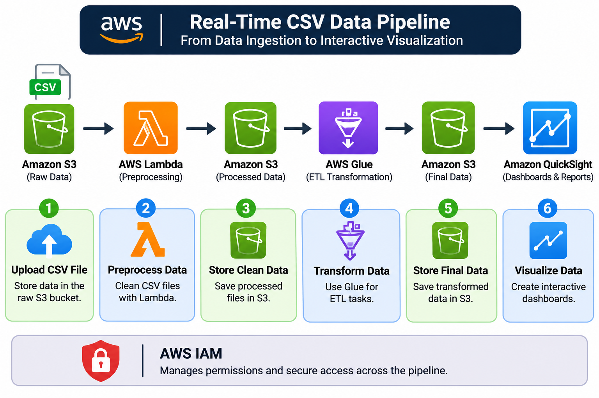

# 📊 AWS Serverless CSV Data Pipeline

An end-to-end, serverless data processing pipeline built using Amazon S3, AWS Lambda, AWS Glue, and Amazon QuickSight. This project automates CSV data ingestion, preprocessing, ETL transformation, and data visualization using AWS managed services.

## 📌 Project Overview

This project demonstrates how multiple AWS services can be integrated to build an automated data pipeline for processing and analyzing CSV files.

The pipeline begins when a CSV file is uploaded to an Amazon S3 raw data bucket. An S3 event notification automatically triggers an AWS Lambda function to preprocess the uploaded data by removing rows containing missing values.

The cleaned data is then stored in a separate S3 processed data bucket, where AWS Glue performs further ETL operations, including schema modification and data transformation.

The final dataset is stored in an Amazon S3 final data bucket and used as a data source for Amazon QuickSight to create interactive dashboards and analytical reports.

## ✨ Project Highlights

- Automated CSV file ingestion using Amazon S3.
- Event-driven data preprocessing using AWS Lambda.
- Automated ETL operations using AWS Glue.
- Centralized data storage using multiple S3 buckets.
- Interactive data visualization using Amazon QuickSight.
- IAM-based access control for AWS service integration.
- End-to-end data processing without managing traditional servers.

## ☁️ AWS Services Used

| AWS Service | Purpose |
|---|---|
| **Amazon S3** | Stores raw, processed, and final datasets. |
| **AWS Lambda** | Automatically preprocesses CSV files when uploaded to the raw S3 bucket. |
| **AWS Glue** | Performs ETL operations, including schema modification and data transformation. |
| **Amazon QuickSight** | Creates interactive dashboards, charts, and analytical reports. |
| **AWS IAM** | Manages permissions and secure access between AWS services. |

## 🏗️ Architecture

The project follows a serverless data pipeline architecture consisting of three main data storage stages: Raw Data, Processed Data, and Final Data.



### Process Workflow

1. **Data Ingestion:** Upload a CSV file into the Amazon S3 raw data bucket.
2. **Event Trigger:** Amazon S3 generates an object creation event that triggers AWS Lambda.
3. **Data Preprocessing:** Lambda reads the uploaded CSV file, extracts the header, and removes rows containing missing values.
4. **Processed Data Storage:** The cleaned CSV file is uploaded to the processed data S3 bucket.
5. **Data Cataloging:** AWS Glue Crawler scans the processed data bucket and creates a table in the Glue Data Catalog.
6. **ETL Transformation:** AWS Glue Visual ETL performs schema modifications and removes unnecessary columns.
7. **Final Data Storage:** The transformed dataset is stored in the final data S3 bucket in GZIP-compressed CSV format.
8. **Data Preparation:** The compressed output is extracted and uploaded as a regular CSV file for the QuickSight data source.
9. **Data Visualization:** Amazon QuickSight connects to the final dataset and generates interactive dashboards and analytical reports.

## 🪣 S3 Bucket Configuration

Three separate S3 buckets are created to organize the different stages of the data pipeline.

| Bucket | Purpose |
|---|---|
| `twy-csv-raw-data-bryan` | Stores original CSV files uploaded by the user. |
| `twy-csv-processed-data-bryan` | Stores preprocessed CSV files generated by Lambda. |
| `twy-csv-final-data-bryan` | Stores the final transformed datasets generated by AWS Glue. |

### Data Processing Structure

```text
Raw Data Bucket
      |
      └── raw/
            └── weather_data.csv

Processed Data Bucket
      |
      └── processed/
            └── weather_data.csv

Final Data Bucket
      |
      └── Transformed CSV Dataset
```

## ⚙️ Implementation Steps

### 1. Create Amazon S3 Buckets

Navigate to Amazon S3 in the AWS Management Console.

Create the following three buckets:

**Raw Data Bucket**
- Bucket Name: `twy-csv-raw-data-bryan`

**Processed Data Bucket**
- Bucket Name: `twy-csv-processed-data-bryan`

**Final Data Bucket**
- Bucket Name: `twy-csv-final-data-bryan`

Keep the default configuration settings and create all three buckets.

### 2. Create IAM Roles

Create two IAM roles to provide the required permissions for Lambda and AWS Glue.

**Lambda Execution Role**

- Trusted Entity: AWS Service
- Use Case: Lambda
- Permission Policies:
  - `AmazonS3FullAccess`
  - `AWSGlueServiceRole`
- Role Name: `Lambda-S3-Glue-Role`

**AWS Glue Service Role**

- Trusted Entity: AWS Service
- Use Case: Glue
- Permission Policies:
  - `AmazonS3FullAccess`
  - `AWSGlueServiceRole`
- Role Name: `Glue-Service-Role`

**Security Note:** For production environments, replace broad S3 permissions with least-privilege IAM policies that grant access only to the required buckets and operations.

### 3. Configure Amazon QuickSight

Navigate to Amazon QuickSight and sign up for the service.

Configuration:

1. Select the same AWS Region used for your S3 buckets.
2. Configure the QuickSight account settings.
3. Navigate to AWS Resources.
4. Enable Amazon S3 access under the QuickSight IAM role settings.
5. Grant access to all three project S3 buckets.
6. Save the configuration.

This allows QuickSight to access the S3 datasets required for visualization.

### 4. Create the AWS Lambda Function

Navigate to AWS Lambda and create a new function.

Configuration:

- Creation Method: Author from Scratch
- Function Name: `CSVPreprocessorFunction`
- Runtime: Python
- Execution Role: Use an existing role
- Existing Role: `Lambda-S3-Glue-Role`

Replace the default Lambda code with the Python implementation provided in the `docs` folder.

**Source Code:** [lambda_function.py](docs/lambda_function.py)

The Lambda function performs the following operations:

- Retrieves the uploaded CSV file from the raw S3 bucket.
- Reads and extracts the CSV header.
- Filters out rows containing missing values.
- Generates a cleaned CSV file.
- Uploads the processed file to the processed data S3 bucket.

Update the destination bucket placeholder in the Lambda code with your actual processed bucket name.

Select **Deploy** after adding the code.

### 5. Configure the Amazon S3 Event Trigger

Configure an S3 event notification to automatically invoke the Lambda function whenever a new CSV file is uploaded.

Configuration:

- Trigger: Amazon S3
- Bucket: `twy-csv-raw-data-bryan`
- Event Type: All Object Create Events
- Prefix: `raw/`
- Suffix: `.csv`

Create a `raw/` folder inside the raw data bucket.

Save the trigger configuration.

**Note:** The Lambda function writes its output to a separate processed data bucket, so this configuration does not create a recursive trigger loop.

### 6. Upload the Raw CSV Dataset

Navigate to the raw S3 bucket:

`twy-csv-raw-data-bryan`

Upload the CSV dataset into the `raw/` folder.

Example:

`weather_data.csv`

Once uploaded:

1. Amazon S3 generates an object creation event.
2. AWS Lambda is automatically triggered.
3. The CSV file is preprocessed.
4. The cleaned dataset is uploaded to the processed data bucket.

Verify that the processed file appears inside:

`twy-csv-processed-data-bryan`

### 7. Configure AWS Glue Database

Navigate to AWS Glue and open the Databases section.

Create a new database.

**Database Name:** `csv_data_pipeline_catalog`

This database will store the metadata and table information discovered by the Glue Crawler.

### 8. Create an AWS Glue Crawler

Navigate to the Crawlers section in AWS Glue.

Create a new crawler.

**Configuration:**

- Crawler Name: `ProcessedCSVDataCrawler`
- Data Source: Amazon S3
- S3 Path: `twy-csv-processed-data-bryan`
- Subsequent Crawler Runs: Crawl all sub-folders
- IAM Role: `Glue-Service-Role`
- Target Database: `csv_data_pipeline_catalog`
- Crawler Schedule: On Demand

Create the crawler and select **Run**.

Once the crawler completes successfully, a new table will be generated in the AWS Glue Data Catalog.

### 9. Create an AWS Glue ETL Job

Navigate to AWS Glue and open:

**ETL Jobs → Visual ETL**

Create a new Visual ETL job.

**Source Configuration:**

- Source: AWS Glue Data Catalog
- Database: `csv_data_pipeline_catalog`
- Table: `twy_csv_processed_data_bryan`
- IAM Role: `Glue-Service-Role`

**Job Name:**

`CSVDataTransformation`

**Transformation Configuration:**

1. Add a Change Schema transformation node.
2. Configure the schema modification.
3. Remove the unnecessary `icon` column.
4. Save the transformation.

**Target Configuration:**

- Target: Amazon S3
- Format: CSV
- Compression Type: GZIP
- Destination Bucket: `twy-csv-final-data-bryan`

Save the job and select **Run**.

Once the Glue job completes successfully, a compressed CSV dataset will be generated in the final data bucket.

### 10. Prepare the Final Dataset for QuickSight

The AWS Glue job generates a GZIP-compressed CSV file.

For this implementation, the compressed output is extracted and converted into a regular `.csv` file before being uploaded to the final S3 bucket for QuickSight ingestion.

Process:

1. Download the GZIP output from the final S3 bucket.
2. Extract the compressed file.
3. Ensure the extracted dataset has a `.csv` extension.
4. Upload the CSV file back into the final S3 bucket.

This provides a regular CSV dataset for the QuickSight S3 data source.

### 11. Configure Amazon QuickSight Dataset

Navigate to Amazon QuickSight.

1. Open the Data section.
2. Select **Create Dataset**.
3. Choose Amazon S3 as the data source.
4. Enter the data source name:

`ProcessedCSV`

5. Upload the S3 manifest JSON file provided in the `docs` folder.

**Manifest File:** [Manifest.json](docs/Manifest.json)

Update the manifest configuration with the actual S3 URI of your final CSV dataset.

After uploading the manifest, create the dataset and verify that the data is successfully imported.

### 12. Create QuickSight Visualizations

Once the dataset is available, create visualizations using the imported weather data.

The following charts were developed:

- **Donut Chart:** Weather condition distribution.
- **Scatter Plot:** Cloud coverage versus solar radiation.
- **Horizontal Bar Chart:** Wind speed analysis.
- **Histogram:** Temperature distribution.

Combine the visualizations into a single interactive dashboard for easier data analysis and reporting.

## 📈 Data Visualization Results

### 1. Weather Condition Distribution

Donut chart displaying the distribution of different weather conditions.


### 2. Cloud Coverage vs Solar Radiation

Scatter plot showing the relationship between cloud coverage and solar radiation.


### 3. Wind Speed Analysis

Horizontal bar chart displaying wind speed measurements across the dataset.


### 4. Temperature Distribution

Histogram displaying the distribution of temperature values.


### 5. Full Interactive Dashboard

The completed Amazon QuickSight dashboard combines all visualizations into a single analytical interface.


## 📚 Key Learning Outcomes

Through this project, I gained practical experience in:

- Building serverless data pipelines using AWS managed services.
- Configuring Amazon S3 event notifications to trigger Lambda functions.
- Processing and cleaning CSV datasets using Python.
- Integrating AWS Lambda with Amazon S3.
- Creating AWS Glue databases, crawlers, and Data Catalog tables.
- Building ETL workflows using AWS Glue Visual ETL.
- Transforming datasets and managing CSV compression formats.
- Connecting Amazon S3 datasets to Amazon QuickSight.
- Developing interactive dashboards and data visualizations.
- Configuring IAM roles and permissions for AWS service integration.

## 📁 Repository Structure

```text
aws-serverless-csv-data-pipeline/
│
├── README.md
│
├── docs/
│   ├── lambda_function.py
│   ├── Manifest.json
│   └── data-processing.py
│
└── images/
    ├── CSV-Data-Pipeline-Topology.png
    ├── weather-condition-distribution.png
    ├── cloud-coverage-vs-solar-radiation.png
    ├── wind-speed-analysis.png
    ├── temperature-distribution.png
    └── weather-dashboard.png
```

## 📝 Project Summary

This project demonstrates how AWS services can be integrated to build a complete serverless data pipeline, from raw CSV ingestion to interactive data visualization.

By combining Amazon S3, AWS Lambda, AWS Glue, and Amazon QuickSight, the solution automates data preprocessing, transformation, storage, and reporting without requiring traditional server infrastructure.

**Architecture:** Amazon S3 (Raw Data) → AWS Lambda → Amazon S3 (Processed Data) → AWS Glue → Amazon S3 (Final Data) → Amazon QuickSight

---

*Built as part of my hands-on AWS cloud engineering, serverless computing, and data analytics portfolio.*
